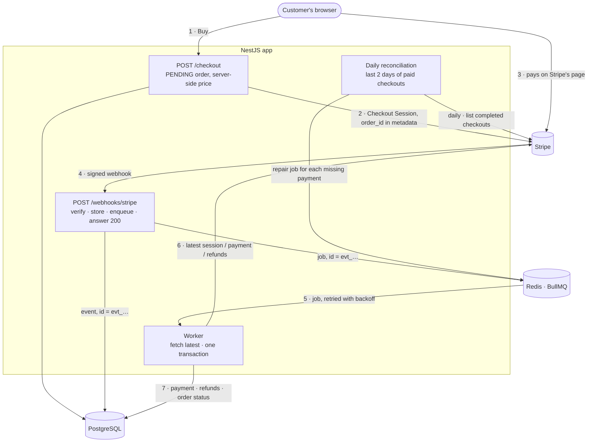
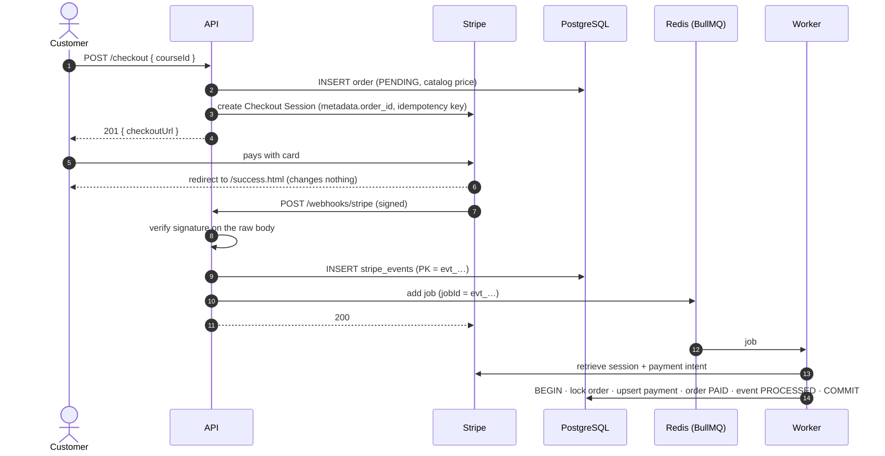
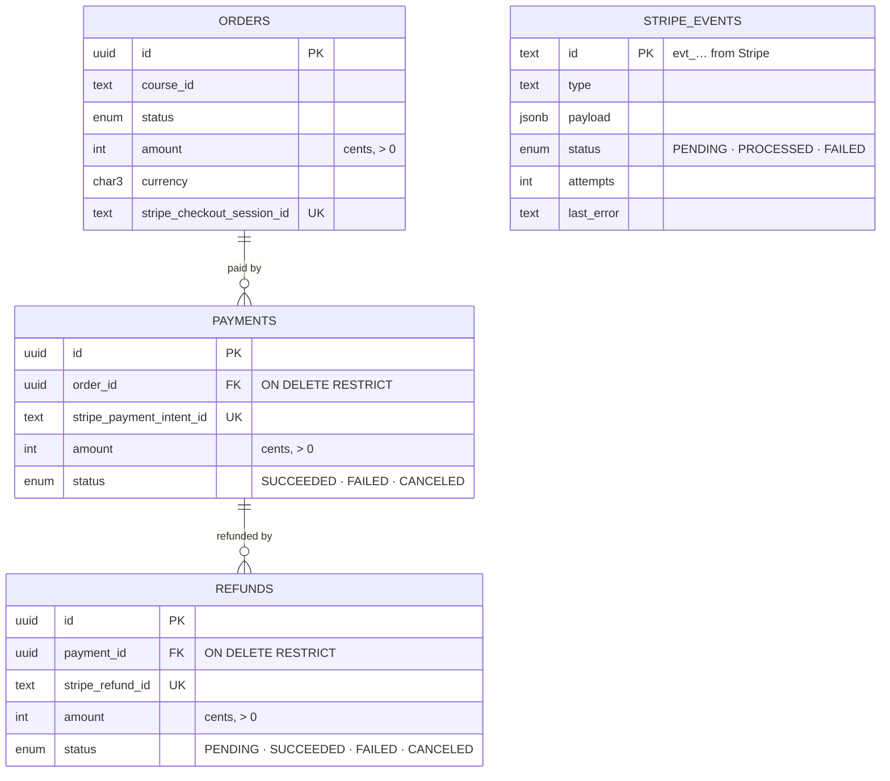
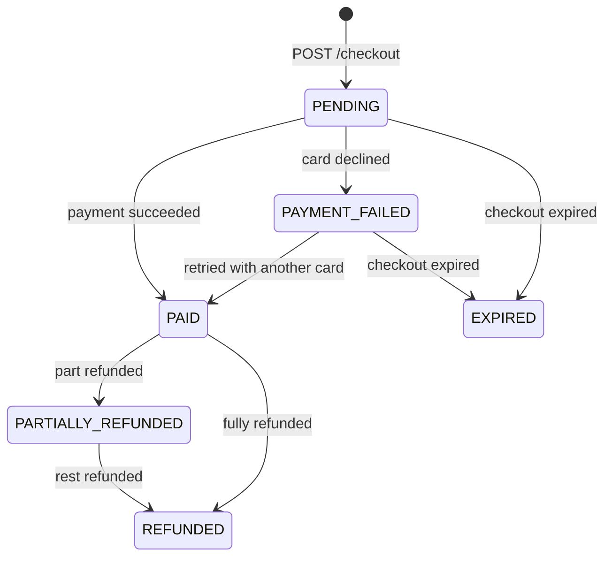

<div align="center">

# Stripe Payment Sync

**Every Stripe payment, failure and refund lands in your database exactly once, even when Stripe repeats itself, the database goes down, or the customer closes the tab.**

[](https://github.com/muhammadasif2017/stripe-payment-sync/actions/workflows/ci.yml)


[](LICENSE)

</div>

> [!NOTE]
> Stripe runs in test mode only; no real money moves. The requirements are in [`PROJECT.md`](PROJECT.md).

---

## Contents

- [The problem](#the-problem)
- [How it works](#how-it-works)
- [Why a queue](#why-a-queue)
- [What it guarantees](#what-it-guarantees)
- [How a payment is never recorded twice](#how-a-payment-is-never-recorded-twice)
- [When things go wrong](#when-things-go-wrong)
- [Run it with Docker](#run-it-with-docker)
- [Quick start for development](#quick-start-for-development)
- [Try it end to end](#try-it-end-to-end)
- [API](#api)
- [Data model](#data-model)
- [Order lifecycle](#order-lifecycle)
- [Configuration](#configuration)
- [Testing](#testing)
- [Project structure](#project-structure)
- [Roadmap](#roadmap)
- [Known limits](#known-limits)
- [Further reading](#further-reading)
- [About this project](#about-this-project)
- [License](#license)

---

## The problem

An online course shop takes payments with Stripe Checkout. Its backend marks an order as paid when the customer **lands on the success page**. Customers who close the tab first have paid but never get their course. Refunds are never recorded, so the sales reports are wrong.

This project fixes it the way Stripe intends: the success page changes nothing, and **Stripe's webhooks are the only source of truth**. Each event is verified, stored once, queued, and applied by a background worker that retries until the database matches Stripe.

## How it works



1. **Checkout.** `POST /checkout` saves a `PENDING` order with the price from the server's catalog, then creates a Stripe Checkout Session carrying the order ID.
2. **Webhook.** Stripe calls `POST /webhooks/stripe`. The endpoint checks the signature, stores the event, adds a queue job and answers `200` in milliseconds. It does no other work.
3. **Worker.** A BullMQ worker picks up the job, fetches the **current** state of the payment from Stripe, and in **one database transaction** writes the payment, the refunds, the new order status and the event's `PROCESSED` mark.
4. **Reconciliation.** Every day the worker lists Stripe's completed checkouts of the last 2 days and queues a repair for any paid one missing from the database: the safety net for a webhook that never arrived.

The API and the worker are the same code, run as two processes (`WORKER_ENABLED`), and in Docker as two containers.

<details>
<summary><b>The same flow as a sequence diagram</b></summary>



</details>

## Why a queue

The webhook could do all the work itself: fetch the payment from Stripe, update the database, answer. It doesn't, for three reasons:

- **Stripe wants a fast answer.** It waits a few seconds, then counts the delivery as failed and sends it again later. Work done inside the request (two Stripe calls, a transaction) makes timeouts and duplicate deliveries likely.
- **Failures become retries, not lost payments.** If the database or Stripe is down, a webhook doing the work can only answer an error and hope Stripe retries. Here the event is already stored and its job sits in Redis; BullMQ retries it 5 times with backoff (10 s, 20 s, 40 s, 80 s), and every attempt's error is saved on the event.
- **The two sides scale and fail separately.** A backlog of jobs never slows the webhook, the worker can restart without dropping anything, and either can be scaled on its own.

The queue job carries only the event ID, and its job ID is that same ID, so a duplicate delivery can't create a second job.

## What it guarantees

| Guarantee | How | Proof |
| --- | --- | --- |
| Only Stripe can create events | HMAC signature checked on the **raw** request body; signatures older than 5 minutes refused | e2e: wrong secret, changed body, old timestamp, missing header, live-mode event → `400`, nothing saved |
| Each event is processed once | Stripe event ID is the table's primary key **and** the queue's job ID; processed events are skipped | e2e: the same event delivered twice → 1 row, 1 job; real `stripe events resend` → logged as duplicate |
| No payment is lost | Event is stored before the `200`; any failure answers `500` so Stripe redelivers; jobs live in Redis, not in memory | Real run: PostgreSQL stopped, jobs failed and retried, completed when it came back |
| Order status is always right | Computed from **all** payments and refunds, not stepped per event; latest objects fetched from Stripe | Unit tests for every status; e2e: refund before payment, late decline after success, cancel after expiry |
| The client can't choose the price | Request accepts only `courseId` and `email`; the server sets amount and currency | e2e: a body with `amount` → `400`, no order |
| Never live mode | Startup refuses keys that aren't `sk_test_…`; live-mode events refused | Unit and e2e tests |

## How a payment is never recorded twice

The brief asks this directly. The answer is four independent layers, each enforced by something stronger than an `if` statement:

1. **The database refuses a second copy of an event.** `stripe_events.id` is Stripe's event ID and the primary key. Two simultaneous deliveries both try to insert; PostgreSQL lets exactly one win.
2. **The queue refuses a second job.** The job ID is the same event ID, and BullMQ ignores a job whose ID already exists.
3. **The worker refuses to redo work.** An event already marked `PROCESSED` is skipped.
4. **Writes are upserts on Stripe's own IDs.** `stripe_payment_intent_id` and `stripe_refund_id` are unique, and the order status is recomputed from scratch. Even processing the same event twice ends in the same rows.

## When things go wrong

| Failure | What happens |
| --- | --- |
| A request with a forged or missing signature | `400`, nothing stored, reason logged (never returned) |
| Stripe delivers an event twice | `200`, still one row and one job |
| PostgreSQL is down when the webhook arrives | `500`; Stripe redelivers later (for up to 3 days in live mode) |
| Redis is down when the webhook arrives | Fails fast with `500` instead of hanging; Stripe redelivers, the stored event is reused and the job is added |
| PostgreSQL is down while the worker runs | Attempt fails, error logged and saved; retried after 10, 20, 40, 80 seconds |
| Stripe rate-limits or has an outage | Retried like any temporary error |
| Event for an unknown order, wrong amount or currency, or an object Stripe says doesn't exist | Fails **at once** (a retry can't fix it); event marked `FAILED` with the reason |
| All 5 attempts fail | Event marked `FAILED` with `attempts = 5` and the last error; the job waits in the dashboard's **Failed** list with a retry button |
| A Stripe call fails | One warning line with the endpoint, event ID, HTTP status (or `no response`), error type and duration |
| The customer closes the tab after paying | Nothing breaks: the webhook, not the browser, marks the order `PAID` |
| A webhook never arrives, or a payment row is lost | The daily reconciliation compares the last 2 days of paid Stripe checkouts with the database and queues a repair for each missing payment; the payment's stuck events become `RECONCILED` and leave the dashboard's Failed list |
| A paid checkout can't be repaired (e.g. its amount doesn't match the order) | Recorded once in `reconciliation_issues`; later runs skip it and log "N open reconciliation issue(s) need review" until `resolved_at` is set |

## Run it with Docker

**You need:** Docker Desktop, a free [Stripe](https://dashboard.stripe.com/register) account in test mode, and the [Stripe CLI](https://docs.stripe.com/stripe-cli) for webhooks. No Node.js needed.

```bash
# 1. Get the code
git clone https://github.com/muhammadasif2017/stripe-payment-sync.git
cd stripe-payment-sync

# 2. Configure: copy the example, then fill in three values (see below)
cp .env.example .env

# 3. Build and start everything: migrations, then the API and the worker
docker compose --profile app up --build -d

# 4. Check it
curl http://localhost:3000/health
# {"status":"ok"}
```

The three values in `.env`:

| Variable | Where it comes from |
| --- | --- |
| `STRIPE_SECRET_KEY` | Stripe dashboard, test mode: **Developers → API keys → Secret key** (`sk_test_…`) |
| `STRIPE_WEBHOOK_SECRET` | `stripe listen --print-secret` (see [step 1 below](#1-forward-stripes-webhooks-to-your-machine)) |
| `ADMIN_PASSWORD` | Any password of 16+ characters, for the dashboard |

If you change `.env` later, apply it with `docker compose --profile app up -d --force-recreate api worker`.

Then open <http://localhost:3000> to buy a course, and follow [Try it end to end](#try-it-end-to-end) from step 1. The dashboard is at <http://localhost:3000/admin/queues> (user `admin`). Logs: `docker compose --profile app logs -f api worker`.

Stop with `docker compose --profile app down`; add `-v` to delete the database and queue data too.

> [!TIP]
> The stack listens on `127.0.0.1` only. If ports `3000`, `5435` or `6380` are taken, set `APP_PORT`, `POSTGRES_PORT` or `REDIS_PORT` in `.env`. If you change `APP_PORT`, change the port in `APP_URL` and in `stripe listen --forward-to localhost:<port>/webhooks/stripe` to match, or payments stay `PENDING`.

## Quick start for development

To run the app on your machine with hot reload, and the databases in Docker.

**You need:** Node.js 22.12+ and npm 11 (`npm install -g npm@11.14.0`), Docker Desktop, a Stripe test account and the Stripe CLI.

```bash
# 1. Install (also generates the Prisma client)
npm install

# 2. Configure: then put your Stripe test key (sk_test_…) and a dashboard password (16+ characters) in .env
cp .env.example .env

# 3. Start PostgreSQL (localhost:5435) and Redis (localhost:6380), without the app containers
docker compose up -d

# 4. Create the tables
npx prisma migrate deploy

# 5. Run the API and the worker
npm run start:dev
```

```bash
curl http://localhost:3000/health
# {"status":"ok"}   (503 {"status":"error"} when PostgreSQL is unreachable)
```

> [!TIP]
> The non-default ports (`5435`, `6380`) avoid clashing with other local databases. Change `POSTGRES_PORT` / `REDIS_PORT` and the two URLs in `.env` if they are taken.

The app **refuses to start** with a missing or invalid setting, and names every problem at once without printing secret values.

## Try it end to end

### 1. Forward Stripe's webhooks to your machine

> [!IMPORTANT]
> The Stripe CLI may log in to **live mode** by default. Run it with your test key so it can only ever see test data.

```bash
# Git Bash
export STRIPE_API_KEY=$(grep '^STRIPE_SECRET_KEY=' .env | cut -d= -f2-)
```

```powershell
# PowerShell
$env:STRIPE_API_KEY = (Select-String '^STRIPE_SECRET_KEY=(.*)' .env).Matches.Groups[1].Value
```

```bash
stripe listen --print-secret        # put this value in .env as STRIPE_WEBHOOK_SECRET, then restart the API
stripe listen --all-snapshot --latest --forward-to localhost:3000/webhooks/stripe
```

`--latest` formats events with the API version the code targets (`2026-09-30.endive`).

### 2. Buy a course

Open <http://localhost:3000>, click **Buy**, and pay with card **4242 4242 4242 4242**, any future date, any CVC. Within a second or two:

```bash
docker compose exec postgres psql -U payments -d payments \
  -c "select status, amount, currency from orders order by created_at desc limit 1"
#  status | amount | currency
# --------+--------+----------
#  PAID   |   4900 | usd
```

### 3. Refund part of it

```bash
stripe refunds create --payment-intent pi_... --amount 1000
```

The order becomes `PARTIALLY_REFUNDED`; refund the rest and it becomes `REFUNDED`.

### 4. Break the database on purpose

In Git Bash (the `VAR=value command` form sets a variable for one command):

```bash
WORKER_ENABLED=false npm run start:dev          # terminal 1: API only
# buy a course, then:
docker compose stop postgres
WORKER_ENABLED=true PORT=3001 npm run start     # terminal 2: worker only; jobs fail and are retried
docker compose start postgres                   # the next retry completes the payment
```

### 5. Watch it in the dashboard

Open <http://localhost:3000/admin/queues> and log in with `ADMIN_USERNAME` / `ADMIN_PASSWORD` from `.env`. Every job is listed by its Stripe event ID; a failed one shows its error and attempt count.

To see a failure and a manual retry, run the worker with a wrong Stripe key. Stripe answers 401, which is retried like any temporary error:

```bash
WORKER_ENABLED=false npm run start:dev                                          # terminal 1: API only
# buy a course, then:
WORKER_ENABLED=true PORT=3001 STRIPE_SECRET_KEY=sk_test_wrong npm run start    # terminal 2: fails 5 times (about 2.5 minutes)
# stop terminal 2, start it again without STRIPE_SECRET_KEY=..., then click Retry on the failed job
```

The log shows each attempt:

```text
WARN [StripeCalls] checkout.sessions.retrieve event=evt_1UR5Ei… status=401 (StripeAuthenticationError) duration=116ms
WARN [StripeEventsProcessor] Event evt_1UR5Ei… failed on attempt 5 (giving up): Error: Invalid API Key provided: sk_test_*rong
 LOG [StripeCalls] checkout.sessions.retrieve event=evt_1UR5Ei… status=200 duration=812ms request=req_hUQZ…
 LOG [StripeEventsProcessor] Processed checkout.session.completed event evt_1UR5Ei… (attempt 6)
```

A manual retry is one extra attempt (attempt 6), not five more. Retrying a job that already completed changes nothing: the worker skips events already `PROCESSED`.

### 6. Lose a payment and let reconciliation find it

Reconciliation runs every day at 03:00 UTC (`RECONCILIATION_CRON`). To see it work, delete a payment from your development database and start a run by hand:

```bash
docker compose exec postgres psql -U payments -d payments \
  -c "delete from payments where stripe_payment_intent_id = 'pi_...'"   # one without refunds
```

On the dashboard, open **Schedulers**, and click **Run now** on `daily-reconciliation`. The log shows something like:

```text
LOG  [StripeCalls] checkout.sessions.list job=reconciliation status=200 duration=1017ms request=req_…
LOG  [ReconciliationService] Reconciliation: checked 5 completed sessions, 1 missing and queued, 3 already recorded, skipped 0 not paid, 1 without order ID, 0 with unknown order
WARN [ReconciliationService] Payment missing for Checkout Session cs_test_…; repair queued
LOG  [StripeEventsProcessor] Repaired Checkout Session cs_test_… (attempt 1)
```

The payment row is back (with a new row ID), and the order status is recomputed. A second run finds nothing missing.

## API

| Method | Path | Body | Response |
| --- | --- | --- | --- |
| `GET` | `/health` | | `200 {"status":"ok"}`, or `503` when PostgreSQL is unreachable |
| `GET` | `/checkout/courses` | | Courses with server-side prices |
| `POST` | `/checkout` | `{ "courseId": "nestjs-fundamentals", "email"?: "..." }` | `201 { orderId, checkoutUrl }`; `400` for an unknown course or any extra field; `429` after 10 requests in a minute from one IP; `502` (generic message) when Stripe fails |
| `POST` | `/webhooks/stripe` | Stripe event, `Stripe-Signature` header | `200 {"received":true}`; `400` for a bad signature or live mode; `500` so Stripe retries |
| `GET` | `/`, `/success.html`, `/cancel.html` | | Minimal checkout pages |
| `GET` | `/admin/queues` | | Bull Board queue dashboard; HTTP Basic auth on every path below it (`401` without it); changes sent from another site get `403` |

```bash
curl -X POST http://localhost:3000/checkout \
  -H 'Content-Type: application/json' \
  -d '{"courseId":"nestjs-fundamentals","email":"buyer@example.com"}'
# 201 {"orderId":"…","checkoutUrl":"https://checkout.stripe.com/…"}
```

**Events stored and processed:** `checkout.session.completed`, `checkout.session.expired`, `payment_intent.payment_failed`, `payment_intent.canceled`, `charge.refunded`, `refund.updated`. Every other type gets `200` and is dropped, so Stripe stops resending it.

## Data model



- **Money is integer cents**, never floats: `0.1 + 0.2` can't go wrong. `CHECK (amount > 0)` on every money column.
- **Every Stripe ID is unique**, which is what makes upserts safe.
- **Financial history can't vanish:** foreign keys are `ON DELETE RESTRICT`, so deleting an order with payments is refused.
- `stripe_events` has no foreign keys on purpose: it is the inbox, written before anything knows which order an event belongs to.

The schema, with a comment on each decision, is in [`prisma/schema.prisma`](prisma/schema.prisma).

## Order lifecycle



The status is **computed**, not stepped: a pure function looks at all succeeded payments and refunds of the order. Events can arrive in any order, or twice, and the result is the same. An expired checkout stays `EXPIRED` unless money was actually paid.

## Configuration

All settings come from environment variables (`.env` locally), validated at startup.

| Variable | Example | Purpose |
| --- | --- | --- |
| `PORT` | `3000` | HTTP port (default 3000) |
| `APP_URL` | `http://localhost:3000` | Where Stripe sends the customer back; no trailing slash |
| `DATABASE_URL` | `postgresql://…:5435/payments` | PostgreSQL |
| `REDIS_URL` | `redis://localhost:6380` | Redis for the queue |
| `STRIPE_SECRET_KEY` | `sk_test_…` | Test-mode secret key; anything else is refused |
| `STRIPE_WEBHOOK_SECRET` | `whsec_…` | Verifies webhook signatures |
| `WORKER_ENABLED` | `true` | `false` runs the API only, so API and worker can run as separate processes |
| `ADMIN_USERNAME` | `admin` | Dashboard login (default `admin`) |
| `ADMIN_PASSWORD` | 16+ characters | Dashboard password; required, no default |
| `RECONCILIATION_CRON` | `0 3 * * *` | When the daily reconciliation runs, as a 5-field cron pattern in UTC |
| `APP_PORT` | `3000` | Docker only: host port for the API container |
| `POSTGRES_USER`, `POSTGRES_PASSWORD`, `POSTGRES_DB`, `POSTGRES_PORT`, `REDIS_PORT` | see `.env.example` | Docker Compose: database credentials and host ports. In the containers, the database and Redis URLs are built from these and point at the service names |
| `TEST_DATABASE_URL` | `…/payments_test` | Database for e2e tests; must differ from `DATABASE_URL` |
| `TEST_REDIS_URL` | `redis://localhost:6380/1` | Redis database for e2e tests; must differ from `REDIS_URL` |

`.env` is git-ignored; [`.env.example`](.env.example) documents every variable.

## Testing

```bash
npm test            # 156 unit tests
npm run test:e2e    # 97 end-to-end tests (needs `docker compose up -d`)
npm run lint
npm run typecheck
npm run build
```

- **Real infrastructure, isolated.** e2e tests run against their own PostgreSQL database (`payments_test`, created and migrated automatically) and their own Redis database. They refuse to start if pointed at the development database or a remote server.
- **No network, no secrets.** Stripe is replaced by a fake client and webhook payloads are signed locally, so the suite runs offline and in CI.
- **CI on every push and pull request** ([`.github/workflows/ci.yml`](.github/workflows/ci.yml)): the five checks against PostgreSQL and Redis services, an audit of the production dependencies, then the Docker image built and the whole stack started and checked.
- **The key tests are proven to catch their bug.** Each was checked by breaking the code on purpose (dropping the job ID, skipping signature checks, an off-by-one in the retry count…) and watching it fail. The full list is in the [build log](docs/BUILD_LOG.md).
- **Verified against real Stripe** at every stage since checkout: test payments with card 4242, `stripe trigger`, event redelivery, refunds, a live database outage, a failed job retried from the dashboard, and a deleted payment restored by reconciliation.

## Project structure

```text
src/
├── main.ts, app.module.ts, app.setup.ts   bootstrap, raw body, checkout pages
├── config/        environment validation (Joi): refuses to start misconfigured
├── prisma/        the single database client
├── stripe/        the Stripe client, pinned API version, logging wrapper for every call
├── checkout/      POST /checkout, course catalog, request validation
├── webhooks/      POST /webhooks/stripe: verify, store, enqueue
├── queue/         BullMQ queue and its retry settings
├── worker/        processor, event handler, status mapping functions
├── admin/         Bull Board at /admin/queues and its Basic auth login
├── reconciliation/ daily run: find paid checkouts missing from the database, queue repairs
└── health/        GET /health readiness check
prisma/            schema and migrations (including hand-written CHECK constraints)
public/            minimal checkout, success and cancel pages
test/              e2e tests and their helpers (isolated database, Redis, signing)
docs/              build log, tech choices, interview questions
Dockerfile         build, runtime and migrate images
docker-compose.yml PostgreSQL and Redis; with --profile app, also migrate, api and worker
.github/workflows/ CI
```

## Roadmap

The project is built in eight stages, each delivered as one reviewed pull request.

- [x] **1. Project setup**: NestJS, Prisma, Docker Compose, validated configuration, health check
- [x] **2. Data model**: events, orders, payments, refunds, with database-level guarantees
- [x] **3. Test checkout**: orders and Stripe Checkout Sessions, minimal pages
- [x] **4. Webhook endpoint**: signature check, store once, queue by event ID
- [x] **5. Worker with retries**: latest-object processing, one transaction, 5 attempts with backoff
- [x] **6. Logging and dashboard**: every Stripe call logged; Bull Board behind a login to inspect and retry failed jobs
- [x] **7. Daily reconciliation**: compare the last two days of Stripe checkouts with the database and repair anything missed
- [x] **8. CI and Docker**: GitHub Actions on every push; `docker compose --profile app up` starts migrations, API, worker, PostgreSQL and Redis

## Known limits

Honest edges of the current version, each with its planned answer:

- **One currency (USD), card payments only.** Multiple currencies are out of scope; Stripe's Adaptive Pricing is turned off. Payment methods that settle days later aren't handled by the webhook; reconciliation records them once Stripe reports the session paid, within its 2-day window.
- **If PostgreSQL is still down on the 5th attempt**, the event can't be marked `FAILED` and stays `PENDING`; the failed job is visible in the dashboard, where it can be retried, and the next reconciliation records the payment.
- **Reconciliation issues are resolved in SQL.** Setting `resolved_at` on a row in `reconciliation_issues` makes the next run try that session again; there is no screen for it yet.
- **The schedule is changed only in `RECONCILIATION_CRON`.** The dashboard refuses "Edit schedule" and "Remove scheduler" (403), because the worker re-registers the scheduler from the setting at every start.
- **Reconciliation looks back 2 days.** A gap older than that (say, an outage over a long weekend plus a missed run) needs a manual look. It repairs payments, never creates orders: a paid session whose order is gone is counted and logged, not recreated.
- **The dashboard login is HTTP Basic auth**: no logout, and outside localhost it must run behind HTTPS (a reverse proxy such as Caddy or nginx in front of the API). Failed logins are limited to 10 per 15 minutes per IP, counted in each API process's memory; behind a proxy, set Express's "trust proxy" so the limit sees client addresses. Bull Board can also delete jobs; a deleted job loses no data, because the event stays in `stripe_events`.
- **Workers keep the newest read from Stripe, timed by PostgreSQL's clock.** A job whose read is older than one already saved for the order reads Stripe again, up to 3 times per attempt. Two assumptions: the database clock never goes back (if it does, the affected order is logged and its jobs fail until the clock catches up), and Stripe's `retrieve` and `list` calls show a change once its webhook is sent (true for list APIs, not for Stripe Search, which this code doesn't use). An event whose reads keep losing for all 5 attempts ends `FAILED` in the dashboard, where it can be retried.
- **Restoring a backup:** `stripe_events.received_at` is set by a trigger, so run `pg_restore` with `--disable-triggers` to keep the original times.
- **Amounts are 32-bit integers**: up to about $21 million per row, plenty for course sales.

## Further reading

| Document | What's in it |
| --- | --- |
| [`docs/BUILD_LOG.md`](docs/BUILD_LOG.md) | What was built at each stage, why each change was made, problems hit and how they were verified |
| [`docs/TECH_STACK.md`](docs/TECH_STACK.md) | Why each technology was chosen |
| [`docs/INTERVIEW_PREP.md`](docs/INTERVIEW_PREP.md) | The questions a client or interviewer asks about this design, answered |
| [`PROJECT.md`](PROJECT.md) | The original brief, acceptance criteria and build plan |

## About this project

Portfolio project, built from a fictional client brief ([`PROJECT.md`](PROJECT.md)) to show how I'd solve it. It wasn't delivered to a client.

## License

[MIT](LICENSE) © 2026 Muhammad Asif
